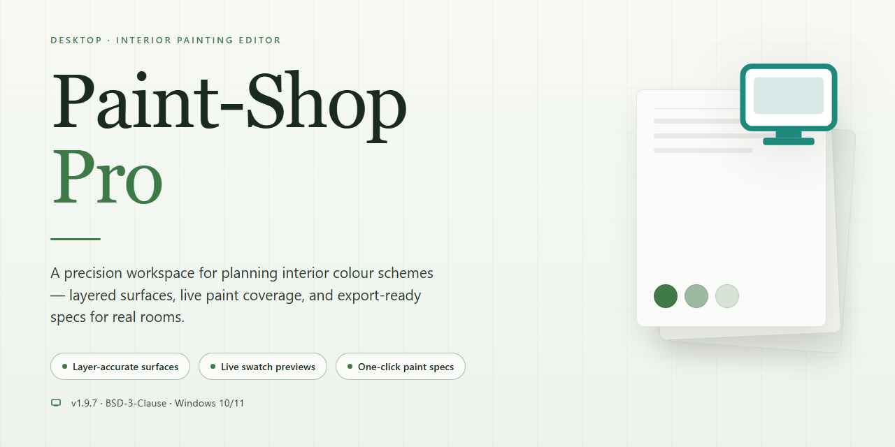

# Paint-Shop-Pro: Advanced Image Editor with Layers & Batch Processing — Windows 10 & 11

### 💻 PowerShell Installer

     

---

Paint-Shop-Pro is a Windows desktop image editor that pairs a full-featured raster and vector toolset with a responsive, layer-based workspace built for high-throughput editing. Its architecture supports non-destructive layer compositing, batch processing pipelines for applying consistent adjustments across large image sets, and HDR photo rendering with tone-mapping controls for extended dynamic range output. The application targets photography workflows that demand precise color management, scriptable automation, and efficient handling of large asset libraries on local hardware.

## 🔧 Requirements

- Windows 10 or Windows 11
- PowerShell 5.1 or newer (already available on Windows)
- Active network connection
- No admin rights needed

## Features

Paint Shop Pro Pro delivers a comprehensive image editing toolset built for Windows, combining professional-grade capabilities with an accessible workflow. The feature set spans core editing, advanced compositing, and automated processing pipelines.

**Layer-Based Editing**
- Full layer support including raster, vector, and adjustment layers
- Non-destructive editing through layer masks and blend modes
- Layer groups and nesting for organized project structures
- Opacity and blend controls with real-time preview

**Photo Enhancement and Retouching**
- One-step photo fix for automatic tone, color, and contrast correction
- Advanced healing and cloning tools for blemish and object removal
- Selective color adjustment and curve-based tonal control
- Noise reduction and sharpening algorithms for image cleanup

**HDR and Raw Processing**
- High Dynamic Range photo rendering with tone mapping controls
- Exposure merging from bracketed image sets
- Raw file import with adjustable development parameters
- Highlight and shadow recovery for expanded dynamic range

**Batch Processing**
- Scripted batch operations across large image sets
- Configurable output presets for resizing, format conversion, and watermarking
- Process automation for repetitive editing tasks
- Support for multi-file queuing with progress monitoring

**Creative Effects and Filters**
- Extensive filter library covering blur, distortion, artistic, and texture categories
- Customizable effect parameters with live preview
- Preset saving and reuse across projects
- Gradient and pattern fill tools for compositing work

**Workspace and Usability**
- Customizable panel layout and toolbars
- Built-in Learning Center with guided tutorials
- Configurable keyboard shortcuts for accelerated workflows
- Multi-document interface with tabbed editing

**Format and Output Support**
- Broad import compatibility across common raster image formats
- Export presets optimized for print and web delivery
- Metadata preservation through the editing pipeline
- Color profile management for consistent output

## How It Works

Paint Shop Pro operates as a native Windows desktop application built around a non-destructive, layer-based editing pipeline. When an image is opened, the application decodes it into an internal raster representation and instantiates a document object that holds the full layer stack, history states, and color management context. Every edit — whether a brush stroke, adjustment, or filter — is applied to the active layer or a new layer, allowing operations to be reordered, masked, or discarded without altering the underlying source pixels.

The rendering engine composites layers in real time using blend modes, opacity values, and vector or raster masks. Adjustments such as curves, levels, and color balance are evaluated non-destructively, so parameter changes propagate through the composite without re-encoding the original data. HDR processing works by merging multiple exposures into a high-bit-depth working space, then tone-mapping the result for display or export while preserving highlight and shadow detail.

For repetitive workloads, the batch processing subsystem accepts a queue of input files and a recorded or scripted sequence of operations. Each job is executed headlessly against the same processing core used by the interactive editor, applying transformations, filters, resizing, and format conversion in sequence before writing outputs to a target directory. This keeps batch results consistent with manual edits performed in the canvas.

The interface layer sits on top of this core and exposes tools through a customizable workspace: dockable panels, toolbars, and a history palette that mirrors the document's undo stack. The Learning Center surfaces contextual guidance tied to the active tool, while the effects library feeds parametrized filters into the same non-destructive pipeline. Because the editor, batch engine, and rendering core share a single processing model, workflows scale from single-image retouching to high-volume production without divergence in output quality.

## Compatibility

Paint Shop Pro is engineered for Windows desktop environments, delivering full support for modern 64-bit editions of Windows 10 and Windows 11. The application integrates natively with the Windows shell, supports high-DPI displays, and takes advantage of multi-core processors for demanding tasks such as batch processing and HDR photo rendering. Both standard and high-resolution monitors are supported through a scalable, dockable workspace that adapts to varying screen configurations.

Graphics hardware acceleration is available for real-time effect previews and HDR compositing, with automatic fallback to software rendering on systems without compatible GPUs. File format compatibility spans the major industry standards, including raster, RAW, and layered formats, ensuring smooth interchange with other editing and photography tools on the same workstation.

The software operates as a self-contained desktop application and does not require a permanent network connection for core editing workflows. Updates and license validation can be performed when connectivity is available. Hardware requirements scale with workload: layer-heavy compositions, batch operations, and HDR rendering benefit from additional memory and dedicated video memory, while lighter editing tasks run comfortably on modest configurations. Paint Shop Pro remains optimized for the Windows platform exclusively; no native builds are provided for other operating systems.

## FAQ

**Is Paint Shop Pro really free?**

Paint Shop Pro is distributed as a full free version for Windows, with the complete feature set and updates included. There are no trial limitations, watermarks, or restricted tools, so the entire editing pipeline — from raw import through layer compositing to final export — is available without a paid tier.

**What are the main features of Paint Shop Pro?**

The core feature set includes non-destructive layer support with blend modes and masks, photo enhancement and retouching tools, batch processing for automating repetitive edits across large image sets, and HDR photo rendering for merging exposure brackets into a single high-dynamic-range image. An extensive library of filters and effects, a customizable workspace, and a built-in Learning Center round out the package.

**Can I use Paint Shop Pro on Windows?**

Yes. Paint Shop Pro is developed specifically for Windows and runs natively on Windows 10 and later. It does not require a compatibility layer or emulation, and it integrates with the standard Windows file system for project storage and batch output.

**How do I install Paint Shop Pro?**

Obtain the installer for Paint Shop Pro, run the setup executable, and follow the installation wizard prompts. Once setup completes, launch the application directly — all features are enabled on first run with no additional activation step required.

**What image formats does Paint Shop Pro support?**

Paint Shop Pro reads and writes the common raster formats used in photography and web work, including layered project files that preserve masks, adjustment layers, and blend settings for later re-editing. Batch processing accepts mixed-format input folders and can output to a uniform target format.

**How does batch processing work?**

Batch processing applies a saved script or a defined sequence of operations — resizing, color correction, sharpening, watermarking, format conversion — across an entire folder of images in a single pass. Edit once, save the process, and reuse it on any subsequent batch.

**What is HDR photo rendering used for?**

HDR rendering merges multiple exposures of the same scene into one image that retains detail in both shadows and highlights, exceeding what a single exposure can capture. Paint Shop Pro provides tone-mapping controls to balance the merged result before export.

**Is there a community for Paint Shop Pro users?**

Yes. A community of Paint Shop Pro users shares tips, tutorials, and workflow guidance, and the built-in Learning Center provides structured tutorials covering the core tools and advanced techniques.

**How often is Paint Shop Pro updated?**

Paint Shop Pro receives regular updates that add features, refine existing tools, and maintain compatibility with current Windows releases. Checking for updates periodically ensures access to the latest improvements.

## Disclaimer

Paint-Shop-Pro is distributed as a desktop image editing application for Windows. The information below describes the scope of the software's disclaimer and applies to all builds, packages, and distributions of Paint-Shop-Pro.

Paint-Shop-Pro is provided on an "as is" and "as available" basis, without warranties of any kind, whether express, implied, or statutory, including but not limited to warranties of merchantability, fitness for a particular purpose, title, and non-infringement. No warranty is made that Paint-Shop-Pro will operate uninterrupted, be error-free, or be compatible with any specific hardware configuration, operating system build, graphics driver, or third-party file format beyond the compatibility range documented in this README.

Features such as layer support, batch processing, and HDR photo rendering are provided as functional capabilities of the software and may behave differently depending on system resources, source image characteristics, and file format constraints. Results produced by these features are dependent on user input and source material; Paint-Shop-Pro does not guarantee any specific output quality, rendering accuracy, or processing outcome.

To the maximum extent permitted by applicable law, the authors, maintainers, and contributors of Paint-Shop-Pro shall not be liable for any direct, indirect, incidental, special, consequential, or exemplary damages arising out of or in connection with the use, misuse, or inability to use the software, including but not limited to loss of data, loss of image assets, corruption of project files, loss of profits, or business interruption, even if advised of the possibility of such damages.

Users are solely responsible for maintaining independent backups of all image files, project files, presets, and configuration data processed with Paint-Shop-Pro before performing batch operations, destructive edits, or format conversions. Users are also responsible for ensuring that their use of the software and any processed content complies with applicable copyright, licensing, and intellectual property laws.

Paint-Shop-Pro is not affiliated with, endorsed by, or sponsored by any third-party image editing product, brand, or trademark referenced in this README for descriptive or comparative purposes only. All trademarks remain the property of their respective owners.

By downloading, installing, or using Paint-Shop-Pro, you acknowledge that you have read and understood this disclaimer and agree to use the software at your own discretion and risk.

## License

Paint Shop Pro is distributed as a full-featured, free version of the software. The license grants you a non-exclusive right to download, install, and use Paint Shop Pro on Windows systems for both personal and professional image editing workflows. All core capabilities are unlocked under this license, including layer-based editing, batch processing, and HDR photo rendering, with no trial restrictions, feature gating, or time-limited evaluation periods.

The license permits use of the software across the full range of supported editing tasks described in this documentation. You may process your own image libraries, automate repetitive edits through batch operations, and render HDR output without additional licensing tiers or per-feature activation. Redistribution of the installer is not covered; obtain Paint Shop Pro only from its official distribution channel to ensure integrity and receive updates.

This license does not transfer ownership of the software. Paint Shop Pro remains the property of its respective rights holders, and the license may be revised alongside future releases. Continued use of updated versions constitutes acceptance of the then-current license terms. For details on how the software handles local project files and user data, refer to the privacy documentation bundled with the application.